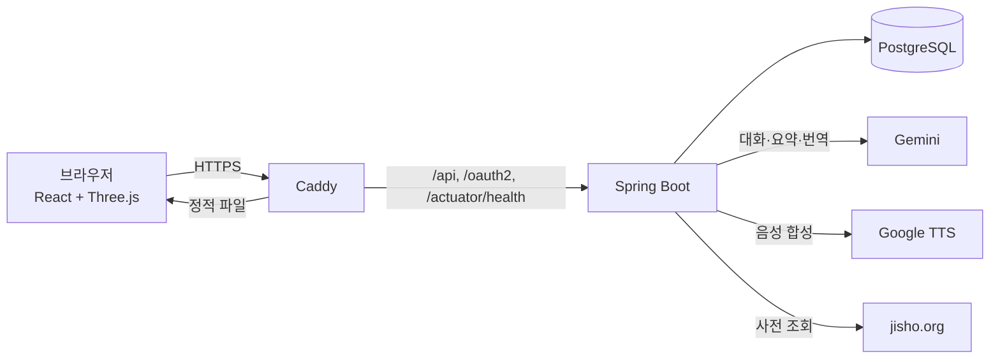

# ことばのまち (kotonoha-machi)

일본어를 공부하며 작은 일본 마을에서 주민들과 일본어로 대화하는 웹 게임입니다. 혼자 설계·개발·배포·운영하는 포트폴리오 프로젝트이고, 이전에 만든 프로토타입을 구조부터 다시 설계해 구현했습니다.

- **배포 주소**: https://kotonohabachi.duckdns.org (GCP VM 한 대에서 운영)
- **상태**: 동작하는 MVP. 학습 콘텐츠는 10개이고, 아래 [한계](#한계와-앞으로-할-일)를 함께 읽어 주세요.

<!-- 스크린샷·시연 영상 추가 예정: 마을 탐험, 주민 대화, 오늘의 학습 -->
> 스크린샷·시연 영상은 추가 예정입니다.

## 주요 기능

| 기능 | 내용 |
| --- | --- |
| 마을 탐험 | Three.js 저폴리 3D 마을과 건물 내부. 고정 각도의 직교 카메라(쿼터뷰), 방향키/WASD와 가상 조이스틱(휴대폰) 이동, 건물 아이콘으로 입장 |
| 주민과 일본어 대화 | Gemini가 주민 설정(성격·배경)을 읽고 답한다. 친밀도(하트로 표시)와 단계별 프롬프트, 지난 대화는 요약 메모 + 최근 대화로 기억, 하루 대화 상한(200회), 지난 대화 날짜별 보기, 타이핑·음성 입력 |
| 오늘의 학습 | 한자 → 단어 → 표현 → 예문 → 독해 → 복습 순서의 5단계+복습. 정답을 맞혀야 다음으로 진행하고, 독해는 일본어 위키백과 지문(출처·라이선스 표기) + 객관식 이해 문제, 복습은 말하기 연습(Web Speech API) |
| 단어장 | 학습한 단어 보관. 대화 중 말풍선의 일본어를 드래그해 저장하면 사전(JMdict 기반)에서 읽는 법·JLPT 레벨·영어 뜻을 가져오고, AI는 한국어로 옮기기만 한다 |
| 음성(TTS) | 주민마다 목소리가 다른 Google Cloud Text-to-Speech(키가 없으면 브라우저 음성으로 대체) |
| 계정 | 이메일 인증 가입, 구글·카카오·네이버 로그인, 캐릭터 꾸미기(피부·머리·옷·신발 등), 일본어 입력 도우미(로마자→가나 변환, 가상 키보드) |

## 설계 원칙과 판단 근거

AI를 어디에 쓰고 어디에 쓰지 않을지를 가장 신경 썼습니다.

- **규칙과 데이터 검증은 AI가 아닌 일반 코드가 한다.** 학습 진행 순서, 하루 1개 제한, 대화 상한, 친밀도 증가 규칙은 서버 코드가 강제합니다. → [0028 친밀도](docs/decisions/0028-friendship-rules-and-heart.md), [0035 대화 하루 상한](docs/decisions/0035-daily-chat-limit.md), [0040 학습 후 대화](docs/decisions/0040-chat-requires-daily-lesson.md)
- **뜻·읽는 법·JLPT 레벨은 AI가 짓지 않는다.** 사전·공개 데이터로 조회하고 대조합니다. AI는 후보 추천(콘텐츠 제작 도구)과 영어 뜻의 한국어 번역까지만 맡습니다. → [0012 콘텐츠 출처](docs/decisions/0012-theme-content-data-source.md), [0036 구글 시트 검수 흐름](docs/decisions/0036-theme-content-google-sheet.md), [0041 대화 단어 저장](docs/decisions/0041-chat-word-save.md)
- **독해 지문도 AI가 짓지 않는다.** 일본어 위키백과 도입 단락을 지문으로 쓰고, 출처를 표기합니다. 독해는 RAG가 아니라 "위키백과 지문 + 이해 문제"입니다. → [0038 위키백과 지문](docs/decisions/0038-wikipedia-passage-daily-lesson.md), [0039 독해 지문·문제](docs/decisions/0039-reading-passage-and-questions.md)
- **학습 콘텐츠는 앱 실행 중 생성하지 않는다.** 로컬 도구(`scripts/import-theme-content`)로 만든 뒤 사람이 검수하고, Flyway 마이그레이션으로 DB에 미리 넣습니다. 앱이 실행 중 Gemini를 부르는 곳은 주민 대화, 하루 대화 요약, 단어 뜻 번역 세 곳뿐입니다.
- **Gemini는 백엔드에서만 호출한다.** 키가 프런트에 노출되지 않고, 호출마다 종류·토큰 수를 기록합니다. → [0018 Gemini Java SDK](docs/decisions/0018-gemini-java-sdk.md), [0045 모니터링](docs/decisions/0045-monitoring-health-and-ai-usage.md)
- **대화 맥락은 요약 + 최근 줄만 보낸다.** 전체 기록을 보내면 비용·지연이 늘어서입니다. → [0029 요약 메모](docs/decisions/0029-chat-context-summary.md), [0032 하루 요약](docs/decisions/0032-daily-chat-summary.md)
- **react-three-fiber 없이 Three.js를 직접 다룬다.** 3D 객체의 생성·정리를 `useRef`/`useEffect`로 직접 관리해 동작 원리를 익히는 것이 목적입니다. → [0001 기술 스택](docs/decisions/0001-tech-stack.md), [0009 렌더링 통일](docs/decisions/0009-character-rendering-threejs.md)
- **주민·건물·학습 데이터는 코드에 박지 않고 구글 시트 → 검토용 SQL → DB로 관리한다.** → [0017 주민](docs/decisions/0017-resident-persona-from-google-sheet.md), [0023 건물](docs/decisions/0023-building-data-from-google-sheet.md)
- **배포는 VM 한 대 + docker compose + Caddy로 단순하게.** 대안(nginx+certbot, 로드밸런서, Cloud Run)과 비교한 이유는 [0042](docs/decisions/0042-gcp-vm-docker-compose-deploy.md), 자동 배포는 [0043](docs/decisions/0043-auto-deploy-github-actions-ssh.md)에 있습니다.

결정 문서 전체 목록은 [`docs/decisions/`](docs/decisions/)에 번호순으로 있습니다. 일부는 아직 "검토 중"으로 표시돼 있습니다.

## 기술 스택

| 영역 | 사용 기술 |
| --- | --- |
| Frontend | Vite, React 19, TypeScript, React Router, Three.js, wanakana |
| Backend | Java 25, Spring Boot 4.1, Spring Security(세션·OAuth2), Spring Data JPA, Flyway, Actuator |
| DB | PostgreSQL 17 |
| 외부 API | Gemini(`google-genai` SDK), Google Cloud Text-to-Speech, Resend(메일), jisho.org 공개 API(사전) |
| 테스트·품질 | JUnit, Testcontainers, Spotless(Google Java Style), Checkstyle, ESLint, Prettier |
| 인프라 | Docker, docker compose, Caddy(HTTPS 자동 발급), GCP Compute Engine, GitHub Actions |

### 구조

```text
backend/src/main/java/com/kotonohamachi/
  auth/ user/ resident/ village/ chat/ theme/ vocabulary/ tts/   # 도메인별 패키지
    controller/ service/ dto/ repository/                        # 엔티티는 도메인 루트
  common/                                                        # 공통 코드
backend/src/main/resources/db/migration/                         # Flyway (V1~V52)
frontend/src/
  pages/ components/ hooks/ lib/ api/ styles/                    # 3D 장면은 components/lib
scripts/
  import-theme-content/   # 학습 콘텐츠 제작·검수 도구 (위키백과·kanjiapi·Tatoeba, 로컬 전용)
  import-residents/ import-buildings/                            # 구글 시트 → 마이그레이션 SQL
docs/                     # 요구사항, 결정 문서, 진행 기록, 배포·모니터링
```

## 아키텍처



프런트와 API가 같은 도메인이라 CORS 없이 세션 쿠키가 동작합니다.

## 로컬 실행

Docker가 필요합니다.

```bash
cp backend/.env.example backend/.env   # 필요한 키만 값을 채운다 (없어도 기동은 된다)
docker compose up --build
```

프런트엔드 http://localhost:5173, 백엔드 http://localhost:8080. `backend/.env`에 쓰는 키 이름은 다음과 같습니다(값은 직접 발급해 넣으세요).

| 키 | 용도 | 비워 두면 |
| --- | --- | --- |
| `GEMINI_API_KEY`, `GEMINI_MODEL` | 주민 대화·요약·번역 | 대화 API가 503 |
| `GOOGLE_TTS_API_KEY` | 음성 합성 | 브라우저 음성으로 대체 |
| `RESEND_API_KEY`, `EMAIL_FROM_ADDRESS` | 가입 인증 메일 | 메일 인증 불가 |
| `GOOGLE_*`, `KAKAO_*`, `NAVER_*` (`CLIENT_ID`/`CLIENT_SECRET`) | 소셜 로그인 | 해당 로그인 불가 |

DB·서버·세션 관련 키(`DB_*`, `SERVER_PORT`, `FRONTEND_ORIGIN`, `SESSION_COOKIE_SECURE`)는 `.env.example`의 기본값을 씁니다.

### 검증 명령어

```bash
# Backend (테스트는 Testcontainers라 Docker 필요)
cd backend && ./gradlew spotlessApply && ./gradlew test

# Frontend
cd frontend && npx prettier --write . && npm run lint && npm run build
```

## 배포와 운영

- GCP Compute Engine VM 한 대에서 `docker-compose.prod.yml`(db·backend·web(Caddy))로 운영합니다. 절차는 [docs/deploy.md](docs/deploy.md).
- master에 머지되면 GitHub Actions가 CI(백엔드 spotless+test, 프런트 prettier+lint+build)를 돌리고, 통과하면 VM에 SSH로 접속해 다시 빌드·실행합니다. → [ci.yml](.github/workflows/ci.yml), [deploy.yml](.github/workflows/deploy.yml)
- `/actuator/health`로 서버·DB 상태를 확인하고, Gemini 호출은 `ai_usage` 테이블에 종류·모델·토큰 수·성공 여부를 기록합니다(프롬프트·대화 내용은 저장하지 않음). 알림 설정과 SQL은 [docs/monitoring.md](docs/monitoring.md).

## 콘텐츠 출처와 라이선스

| 데이터 | 출처 | 비고 |
| --- | --- | --- |
| 독해 지문 | 일본어 위키백과 | CC BY-SA 4.0. 화면에 문서 제목·링크·라이선스를 표기 |
| 한자·단어의 읽는 법·JLPT 레벨·뜻 | [kanjiapi.dev](https://kanjiapi.dev) (KANJIDIC2 + JMdict, EDRDG) | 콘텐츠 제작 시 조회·대조 |
| 대화 중 저장한 단어의 사전 데이터 | jisho.org 공개 API (JMdict 기반) | 단어장 화면에 JMdict 출처 표기, 한국어 뜻은 Gemini 번역 |
| 예문 | Tatoeba | CC BY, 한국어 번역이 있는 문장 |

한국어 뜻은 영어 사전 뜻을 AI가 옮긴 것이라 "검수 필요" 표시를 거쳐 사람이 확인한 뒤 반영했습니다. 이 저장소 자체의 라이선스 파일은 아직 없습니다.

## 한계와 앞으로 할 일

- **Gemini 무료 한도**: 무료 티어는 모델당 하루 20회 수준이라([0033](docs/decisions/0033-gemini-free-tier-limits.md)) 대화가 막힐 수 있습니다. 한도에 걸리면 "주민이 졸려요" 안내가 나옵니다. 결제 연결과 예산 알림은 남은 일입니다.
- **브라우저**: 데스크톱 Chrome을 권장합니다. 음성 인식은 Web Speech API라 브라우저·기기에 따라 다르고, 모바일·iOS 마이크는 불안정할 수 있습니다. 실기기 Safari 확인은 하지 못했습니다.
- **학습 콘텐츠가 적음**: 오늘의 학습은 10개입니다. 날짜와 연동해 매일 새 학습을 내는 방식, 스케줄러로 자동 생성하는 기능은 구현하지 않았습니다.
- **말하기 복습**: 음소 단위 채점이 아니라 인식된 글자와의 유사도 비교이고, 통과 조건이 아닌 연습용입니다([0037](docs/decisions/0037-speech-candidates-and-skip.md)).
- **단어장 사전 조회**: 외부 공개 API(jisho.org)에 의존하고, 활용형은 기본형으로 골라야 조회됩니다([0041](docs/decisions/0041-chat-word-save.md)).
- **미구현**: 마을·집 꾸미기, 앱(모바일) 배포.
- **자동 테스트**: 백엔드는 JUnit·Testcontainers 테스트가 있지만, 프런트엔드는 테스트 체계가 없습니다.
- 그 밖의 남은 작업은 [docs/remaining-work.md](docs/remaining-work.md), [docs/chat-todo.md](docs/chat-todo.md), 날짜별 진행 기록은 [docs/progress.md](docs/progress.md)에 있습니다. 일부 문서는 작성 시점의 상태를 담고 있어 현재와 다를 수 있습니다.
