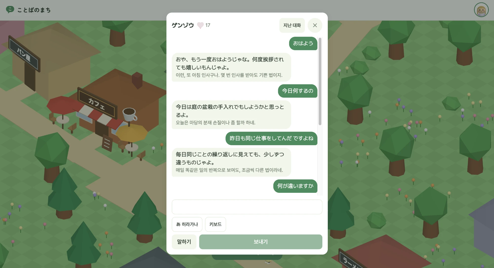
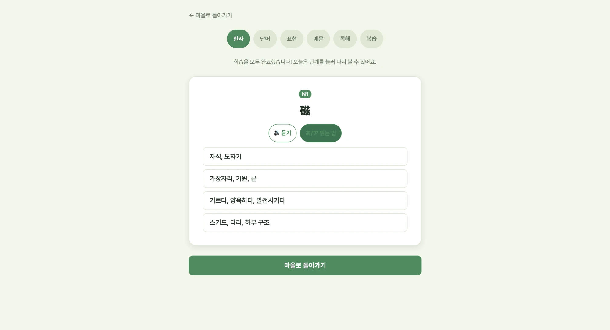
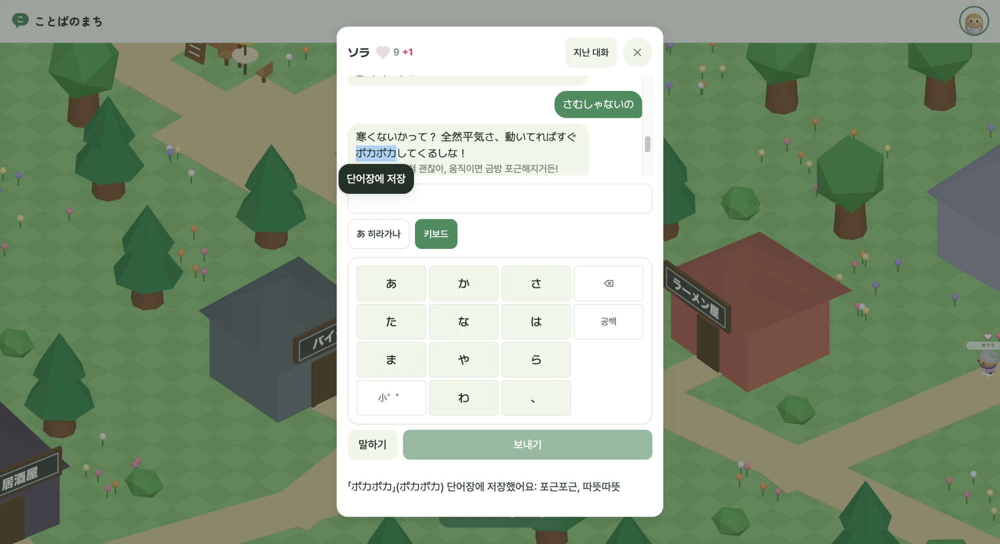
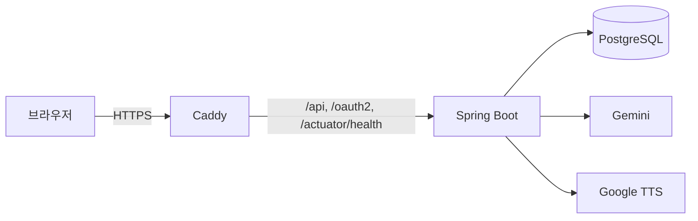

# ことのはまち (Kotonoha Machi)

> 일본어를 배우며 만드는 나만의 작은 마을  
> 하루 한 학습과 3D 마을 속 AI 주민 대화를 결합한 일본어 학습 웹 서비스입니다.  
> 혼자 설계·개발·배포·운영하고 있습니다.

- **배포 주소**: https://kotonohabachi.duckdns.org
- **권장 환경**: 데스크톱 Chrome (말하기 연습이 브라우저 음성 인식을 씁니다)

| 주민과 일본어 대화 | 오늘의 학습 | 대화 중 단어 저장 |
| --- | --- | --- |
|  |  |  |

## 주요 기능

- **3D 마을 탐험**: Three.js 저폴리 마을·건물 내부, 직교 카메라, 키보드/가상 조이스틱 이동
- **주민과 일본어 대화**: Gemini 기반, 친밀도, 요약 메모로 지난 대화 기억, 하루 대화 상한, 지난 대화 보기
- **오늘의 학습**: 한자 → 단어 → 표현 → 예문 → 독해 → 복습(말하기). 독해는 일본어 위키백과 지문(출처 표기) + 이해 문제
- **단어장**: 학습 단어 자동 저장, 대화 중 드래그로 단어 저장(사전 조회 + 한국어 뜻), 레벨별 탭
- **음성**: 주민 성별에 맞는 목소리 TTS(Google Cloud), 말하기는 Web Speech API
- **계정**: 구글·카카오·네이버 로그인, 캐릭터 꾸미기

## 설계 원칙

- **규칙·검증은 AI가 아닌 일반 코드로.** 학습 순서, 하루 제한, 친밀도 규칙은 서버가 강제합니다. → [0035](docs/decisions/0035-daily-chat-limit.md)
- **뜻·읽는 법·JLPT는 AI가 짓지 않고** 사전·공개 데이터로 조회합니다. AI는 후보 추천, 한국어 번역, 이해 문제 생성(정답을 가린 재풀이 검증을 통과한 것만 쓰고 표본은 사람이 확인)까지만 맡고, 학습 콘텐츠는 미리 만들어 DB에 넣습니다. → [0012](docs/decisions/0012-theme-content-data-source.md), [0039](docs/decisions/0039-reading-passage-and-questions.md)
- **Gemini는 백엔드에서만 호출.** 앱 실행 중 호출은 대화·하루 요약·단어 뜻 번역뿐이고, 대화 맥락은 요약 + 최근 줄만 보내 비용을 줄입니다. → [0029](docs/decisions/0029-chat-context-summary.md)

그 밖의 결정(Three.js 직접 관리, VM 한 대 + docker compose + Caddy 등)은 [`docs/decisions/`](docs/decisions/)에 번호순으로 있습니다.

## 기술 스택과 구조

| 구분 | 기술 |
| --- | --- |
| Frontend | Vite, React 19, TypeScript, React Router, Three.js, wanakana |
| Backend | Java 25, Spring Boot 4.1, Spring Security(세션·OAuth2), JPA, Flyway, Actuator |
| DB | PostgreSQL 17 |
| 외부 API | Gemini(`google-genai`), Google Cloud TTS, jisho.org |
| 품질 | JUnit, Testcontainers, Spotless, Checkstyle, ESLint, Prettier |
| 인프라 | Docker Compose, Caddy(자동 HTTPS), GCP VM, GitHub Actions |

```text
kotonoha-machi
├── backend/src/main
│   ├── java/com/kotonohamachi
│   │   ├── auth/          소셜 로그인(구글·카카오·네이버)·세션·탈퇴
│   │   ├── user/          프로필·캐릭터 꾸미기
│   │   ├── village/       마을 지도·건물·마지막 위치
│   │   ├── resident/      주민·친밀도
│   │   ├── chat/          주민 대화(Gemini)·대화 기록·요약·AI 사용량
│   │   ├── theme/         오늘의 학습(6단계)
│   │   ├── vocabulary/    단어장·대화 단어 저장
│   │   ├── tts/           음성 합성(Google TTS)
│   │   └── common/        예외 처리·보안 설정
│   │       (각 도메인: controller / service / dto / repository, 엔티티는 도메인 루트)
│   └── resources/db/migration/   Flyway (스키마, 주민·건물·학습 데이터)
├── frontend/src
│   ├── pages/             화면(마을, 건물 내부, 학습, 단어장, 프로필 등)
│   ├── components/        3D 장면, 대화창, 조이스틱, 일본어 입력
│   ├── hooks/ lib/        음성 인식, Three.js 모델·장면 보조
│   └── api/               백엔드 호출
├── scripts/               학습 콘텐츠·주민·건물 데이터 제작 도구 (로컬 전용)
└── docs/                  요구사항, 결정 문서, 진행 기록, 배포·모니터링
```

## API

세션 쿠키로 로그인하고, 오류는 `{ "message": "..." }`로 응답합니다. 주요 엔드포인트만 적었습니다.

| 영역 | 메서드 · 경로 | 설명 |
| --- | --- | --- |
| 인증 | `/oauth2/authorization/{google,kakao,naver}` | 소셜 로그인 시작(세션 발급) |
| | `GET` · `DELETE /api/auth/me` | 현재 사용자 조회, 회원 탈퇴 |
| 프로필 | `GET /api/users/me` | 내 정보와 캐릭터 |
| | `PATCH /api/users/me/avatar` | 캐릭터 꾸미기 저장 |
| 마을 | `GET /api/village/buildings` | 건물 목록 |
| | `GET` · `PUT /api/village/position` | 마지막 위치 조회·저장 |
| 주민 대화 | `POST /api/residents/{slug}/chat` | 대화 한 턴(답변, 번역, 친밀도 변화) |
| | `GET /api/residents/{slug}/chat/days` | 지난 대화 날짜 목록 |
| 오늘의 학습 | `GET /api/themes/today-recommendation` | 오늘의 학습 추천 |
| | `GET /api/themes/{id}/stages/{stage}/content` | 단계별 문제 |
| | `POST /api/themes/{id}/stages/{stage}/complete` | 단계 완료 |
| | `GET /api/themes/{id}/reading` | 독해 지문·출처·이해 문제 |
| 단어장 | `GET /api/vocabulary` | 단어 목록(레벨·페이지) |
| | `POST /api/vocabulary/chat` | 대화 중 고른 단어 저장 |
| 음성 | `GET /api/tts` | 일본어 음성 합성(`audio/mpeg`) |
| 운영 | `GET /actuator/health` | 상태 확인(로그인 불필요) |



## 로컬 실행

```bash
cp backend/.env.example backend/.env   # 키 값은 직접 발급해 채운다 (없어도 기동은 된다)
docker compose up --build              # 프런트 :5173, 백엔드 :8080
```

```bash
cd backend && ./gradlew spotlessApply && ./gradlew test
cd frontend && npx prettier --write . && npm run lint && npm run build
```

## 배포·운영

master 머지 → GitHub Actions CI(백엔드 Spotless 검사·테스트, 프런트 Prettier·ESLint·빌드) 통과 → VM에 SSH로 접속해 자동 재빌드·배포. 외부 공개 포트는 80/443(관리용 SSH 제외)이고 backend·db는 내부망에서만 통신합니다. 상태 확인은 `/actuator/health`(세부 정보 없음, 로그인 불필요), 가동 이력은 GCP 업타임 체크로 봅니다.
세부: [docs/deploy.md](docs/deploy.md), [docs/monitoring.md](docs/monitoring.md), [ci.yml](.github/workflows/ci.yml), [deploy.yml](.github/workflows/deploy.yml)

## 콘텐츠 출처

- 독해 지문: 일본어 위키백과 (CC BY-SA 4.0, 화면에 출처·라이선스 표기)
- 한자·단어 데이터: [kanjiapi.dev](https://kanjiapi.dev) (KANJIDIC2 + JMdict, EDRDG 라이선스)
- 대화에서 저장한 단어: 읽는 법·영어 뜻은 jisho.org API(JMdict 기반, CC BY-SA 4.0), JLPT 레벨은 jisho.org의 JLPT 태그. 한국어 뜻은 영어 뜻을 Gemini가 옮긴 것
- 예문: Tatoeba (CC BY 2.0 FR)
